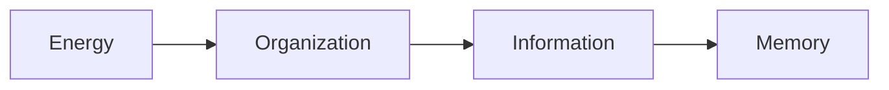
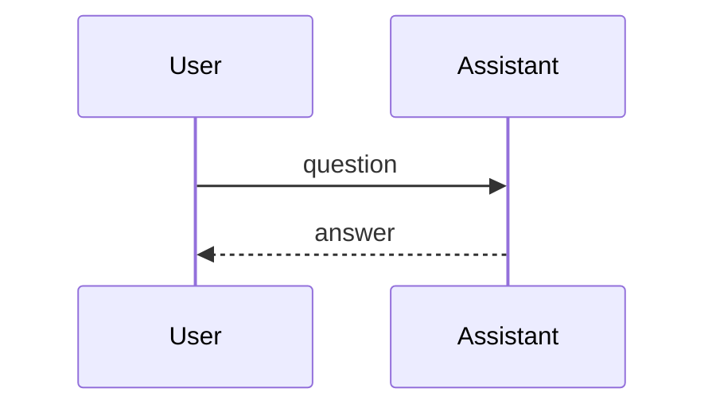

# What renders well in mdview

Open this file in mdview to see every construct below rendered. Ask an AI to use them and its replies will look right when you save them as `.md`.

## Conversation structure

Use one heading per speaker (or a bold label). mdview colours the turns, adds fold / copy buttons and `[` `]` navigation.

```markdown
## User
…your message…

## Assistant
…the reply…
```

## Math (KaTeX)

Inline: $E = mc^2$ and \(\tilde{\mu} = \mu^0 + RT\ln a\). Display, with line breaks and `=` on its own line:

$$
\tilde{\mu}
=
\mu^0 + RT\ln a + zF\phi
$$

\[
\Delta G = \Delta H - T\Delta S
\]

\begin{align}
a &= b + c \\
  &= d
\end{align}

```math
\int_0^\infty e^{-x^2}\,dx = \frac{\sqrt{\pi}}{2}
```

## Diagrams





An SVG fence is drawn as a picture (its source stays available underneath):

```svg
<svg viewBox="0 0 220 70" xmlns="http://www.w3.org/2000/svg">
  <rect width="220" height="70" rx="8" fill="#e8f0fe"/>
  <circle cx="40" cy="35" r="18" fill="#1f6feb"/>
  <text x="70" y="40" font-family="Segoe UI, Arial" font-size="16" fill="#1f2328">SVG works</text>
</svg>
```

## Code

```python
def nernst(c_out, c_in, z=1, T=310.0):
    R, F = 8.314, 96485.0
    return (R * T) / (z * F) * math.log(c_out / c_in)
```

```powershell
Get-ChildItem -Recurse -Filter *.md | Sort-Object LastWriteTime -Descending | Select-Object -First 5
```

## Tables, lists, tasks

| Quantity | Symbol | Unit |
|:---------|:------:|-----:|
| Energy   | $E$    | J    |
| Entropy  | $S$    | J/K  |

- [x] done
- [ ] not yet

1. first
2. second
   - nested

Term
: A definition list entry

## Callouts

> [!NOTE]
> Useful information.

> [!TIP]
> A helpful suggestion.

> [!IMPORTANT]
> Key information.

> [!WARNING]
> Urgent: needs attention.

> [!CAUTION]
> Risk of a bad outcome.

## Collapsible sections

<details>
<summary>Reasoning (click to expand)</summary>

Markdown works **inside** if there is a blank line after `<summary>…</summary>`.

</details>

## Small things

H<sub>2</sub>O, x<sup>2</sup>, <kbd>Ctrl</kbd>+<kbd>C</kbd>, <mark>highlighted</mark>, ~~struck~~, a footnote[^1], and a bare link https://example.com/docs.

[^1]: Footnotes appear at the end.
