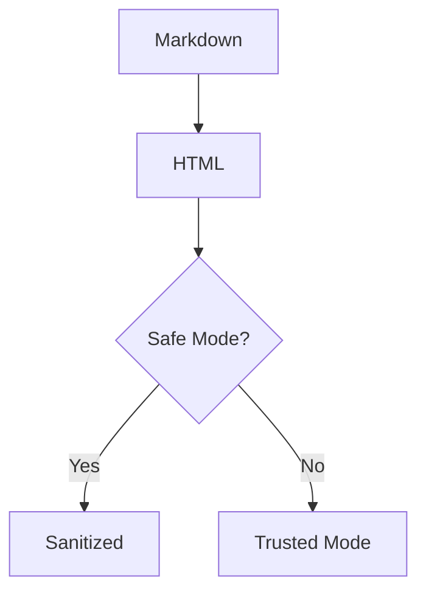

# Markdown Feature Tour

A single document that exercises every feature the viewer supports. Open it with
`py mdview.py samples/features.md` (add `--trusted` to see the trusted-mode demo at the end).
The YAML block above is **front matter** and must not appear on the page.

**Contents:**
[Text](#text-formatting) ·
[Headings](#headings) ·
[Lists](#lists) ·
[Tables](#tables) ·
[Code](#code) ·
[Quotes](#blockquotes) ·
[Links](#links) ·
[Images](#images) ·
[Math](#math) ·
[Footnotes](#footnotes) ·
[Definitions](#definition-lists) ·
[HTML](#raw-html) ·
[Misc](#miscellaneous)

---

## Text formatting

Plain text, *italic*, _also italic_, **bold**, __also bold__, ***bold italic***,
~~strikethrough~~, and `inline code`. Combine them: **bold with `code` and *nested italic***.

Escapes: \*not italic\*, \`not code\`, \# not a heading, 1\. not a list, and a literal dollar sign \$5.

A hard line break using two trailing spaces  
continues here, and one using a backslash\
continues here. A single newline
inside a paragraph stays in the same paragraph.

Unicode works: café, naïve, Ελληνικά, 日本語のテキスト, العربية, 🚀 ✅ ❤️.

## Headings

# H1 heading
## H2 heading
### H3 heading
#### H4 heading
##### H5 heading
###### H6 heading

Setext heading level 1
======================

Setext heading level 2
----------------------

### Heading with `code` and *emphasis*

### Duplicate heading

### Duplicate heading

(The two headings above must get different anchor ids: `duplicate-heading` and `duplicate-heading-1`.)

## Lists

Unordered (nested, mixed markers):

- Fruit
  - Apple
    - Granny Smith
    - Fuji
  - Banana
- Vegetables
  * Carrot
  * Leek
+ Grains

Ordered, starting at 3:

3. Third
4. Fourth
   1. Nested first
   2. Nested second
5. Fifth

Loose list with paragraphs and a code block:

1. First item

   A second paragraph inside the item.

   ```text
   code inside a list item
   ```

2. Second item

Task list:

- [x] Write the parser
- [x] Sanitize raw HTML
- [ ] Ship it
  - [ ] Nested unchecked
  - [x] Nested checked

## Tables

| Left aligned | Centered | Right aligned |
|:-------------|:--------:|--------------:|
| `code`       | **bold** |          1.50 |
| *italic*     | ~~gone~~ |        200.00 |
| A \| pipe    | [link](#links) |    3.14 |

| Feature | Supported |
|---|---|
| Line break in a cell | line one<br/>line two |
| Emoji | ✅ |

Wide table (should scroll horizontally instead of breaking the layout):

| c1 | c2 | c3 | c4 | c5 | c6 | c7 | c8 | c9 | c10 | c11 | c12 |
|----|----|----|----|----|----|----|----|----|-----|-----|-----|
| aaaaaaaaaaaa | bbbbbbbbbbbb | cccccccccccc | dddddddddddd | eeeeeeeeeeee | ffffffffffff | gggggggggggg | hhhhhhhhhhhh | iiiiiiiiiiii | jjjjjjjjjjjj | kkkkkkkkkkkk | llllllllllll |

## Code

Python with syntax highlighting and a copy button:

```python
from dataclasses import dataclass

@dataclass
class Point:
    x: float
    y: float

    def norm(self) -> float:
        return (self.x ** 2 + self.y ** 2) ** 0.5

print(Point(3, 4).norm())  # 5.0
```

JavaScript, JSON, shell, PowerShell, SQL, and a diff:

```javascript
const sum = (...xs) => xs.reduce((a, b) => a + b, 0);
console.log(`total: ${sum(1, 2, 3)}`);
```

```json
{ "name": "mdview", "features": ["tables", "math", "footnotes"], "ok": true }
```

```bash
for f in *.md; do echo "rendering $f"; done
```

```powershell
Get-ChildItem -Filter *.md | ForEach-Object { $_.Name }
```

```sql
SELECT name, COUNT(*) AS n FROM docs WHERE published GROUP BY name ORDER BY n DESC;
```

```diff
- old line
+ new line
```

No language given:

```
plain text block, no highlighting
```

Tilde fence with an unknown language (must fall back to plain text, not crash):

~~~notalanguage
some text in a made-up language
~~~

A very long line (should scroll inside the block, not widen the page):

```text
0123456789 0123456789 0123456789 0123456789 0123456789 0123456789 0123456789 0123456789 0123456789 0123456789 0123456789 0123456789
```

Indented code block:

    four spaces make this a code block
    it is not highlighted

A Mermaid block renders as an actual diagram once you've run `--setup-mermaid` once
(otherwise it shows as the plain diagram source below):



## Blockquotes

> A quote with **formatting** and a [link](#links).
>
> > A nested quote.
> >
> > - with a list
> > - inside it
>
> Back to the outer level.

## Links

- Inline: [example](https://example.com "Title on hover")
- Reference style: [reference link][ref] and [another][2]
- Collapsed reference: [ref][]
- Autolink: <https://example.com/autolink>
- Bare URL (linkify): https://example.org/path?query=1 and www.example.net
- Email autolink: <someone@example.com>
- Relative link to another document: [linked.md](linked.md)
- Anchor to a heading in this page: [jump to Footnotes](#footnotes)
- Link with an image: [](https://example.com)
- Blocked scheme (rendered as plain text, not clickable): [bad](javascript:alert(1))

[ref]: https://example.com/reference "Reference title"
[2]: https://example.com/second

## Images

Local image with a title (loaded from this folder):


Image sized with HTML:


Remote image (blocked in Safe Mode; shows a placeholder, and no network request is made):


## Math

Inline math with dollars: $E = mc^2$ and $\sum_{i=1}^{n} i = \frac{n(n+1)}{2}$.

Display math:

$$
\int_{-\infty}^{\infty} e^{-x^2}\,dx = \sqrt{\pi}
$$

Bracket-style math is normalized too: \(a^2 + b^2 = c^2\) inline, and display:

\[
\frac{-b \pm \sqrt{b^2 - 4ac}}{2a}
\]

A matrix:

$$
\begin{pmatrix} a & b \\ c & d \end{pmatrix}
$$

An environment that KaTeX handles (MathML fallback may show it as raw red text):

$$
\begin{aligned}
f(x) &= (x+1)^2 \\
     &= x^2 + 2x + 1
\end{aligned}
$$

Intentionally broken math (must show as raw text, never disappear): $\frac{1}{$

Math inside code stays literal: `$E = mc^2$`.

## Footnotes

Footnotes link both ways.[^first] You can have several[^second], including ones with
formatting[^rich].

[^first]: The first footnote. Use the ↩ link to jump back.
[^second]: A second, short footnote.
[^rich]: A footnote with **bold**, `code`, and a [link](https://example.com).

## Definition lists

Markdown
: A lightweight markup language.

Viewer
: A program that renders documents.
: Also: a person who watches.

## Raw HTML

Allowed tags survive Safe Mode: <kbd>Ctrl</kbd> + <kbd>F</kbd>, <mark>highlighted</mark>,
H<sub>2</sub>O, x<sup>2</sup>, <ins>inserted</ins>, <u>underlined</u>,
<abbr title="HyperText Markup Language">HTML</abbr>, and a line<br>break.

<details>
<summary>Click to expand (a details block)</summary>

Hidden content with **Markdown** inside.

</details>

<div align="center">

Centered content in a `div`.

</div>

Dangerous HTML is removed in Safe Mode. The next line contains a script, an iframe, an `onerror`
handler and a `javascript:` link; **none of them may appear or run**:

<script>window.__pwned = true</script>
<iframe src="https://example.com"></iframe>

<a href="javascript:alert(1)">bad link text stays</a>

## Miscellaneous

Three different source syntaxes below, all rendering as the identical `<hr>` element -
that's expected, not a bug:

---

***

___

HTML comments are dropped: <!-- this text must not be visible -->end of line.

Trailing section for scroll and anchor tests. Jump back to the [top](#markdown-feature-tour).

## Trusted-mode demo

Only in `--trusted` mode does the script below run and append the text "[trusted]" to the
browser tab title. In Safe Mode it is stripped and the title stays unchanged.

<script>document.title += " [trusted]"</script>
